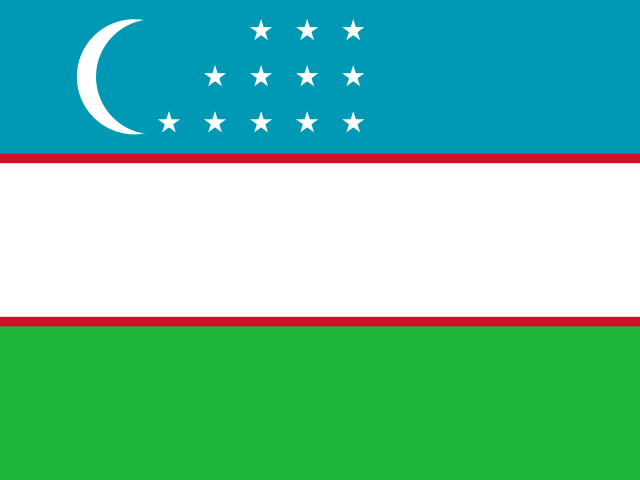
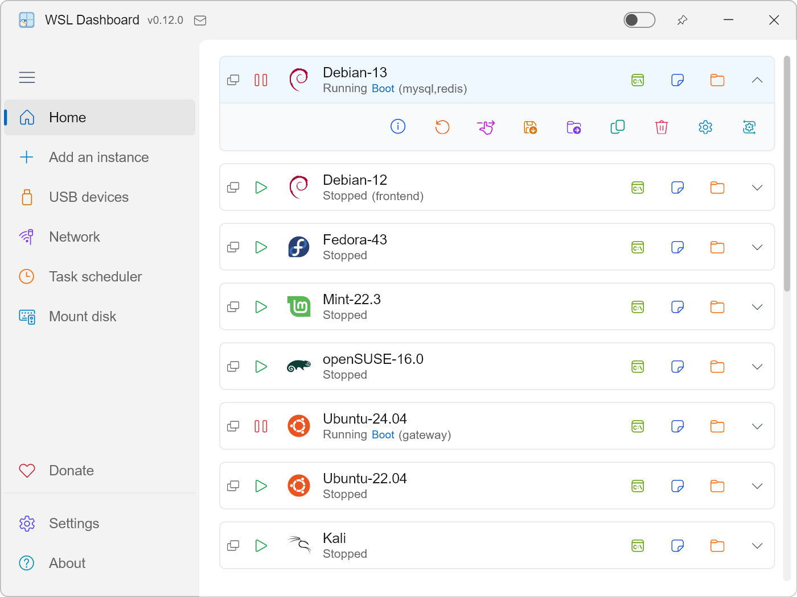
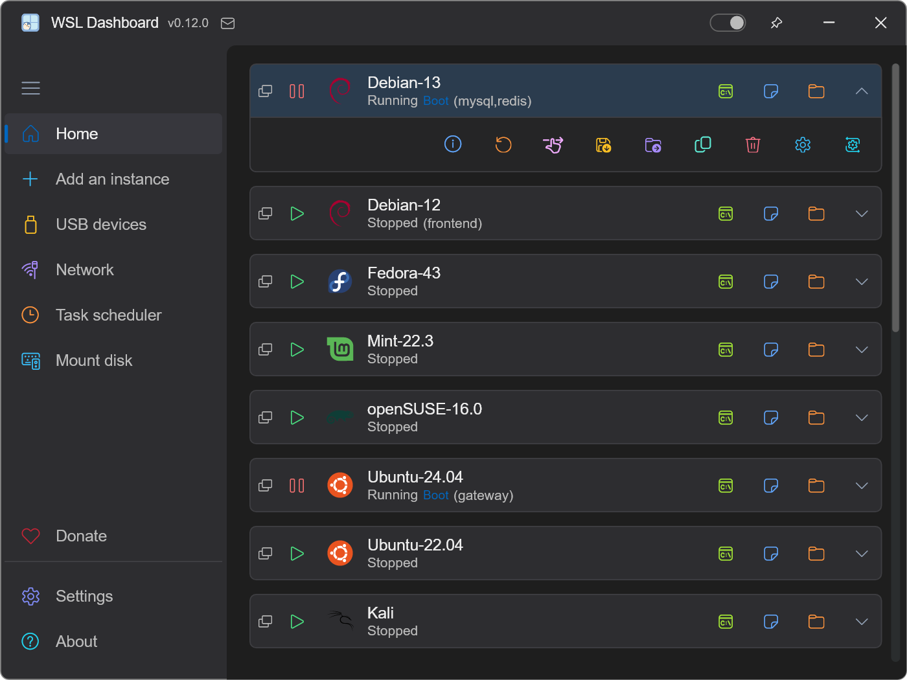

# WSL Dashboard

<p align="center">
  
</p>

Een modern, krachtig, lichtgewicht en geheugenzuinig dashboard voor het beheren van WSL-instanties (Windows Subsystem for Linux). Gebouwd met Rust en Slint voor een premium native ervaring.

```diff
Mededeling:

- WSL Dashboard wordt niet verspreid via de Microsoft Store.
- Elke applicatie die daar onder de naam "WSL Dashboard" wordt vermeld, is niet geautoriseerd en kan vals zijn.
- Gelieve het niet te downloaden om mogelijke oplichting te voorkomen.
```

---

<p align="left">
  <a href="https://www.rust-lang.org" target="_blank"></a>
  <a href="https://slint.dev" target="_blank"></a>
  <a href="https://tokio.rs" target="_blank"></a>
  <a href="https://github.com/microsoft/windows-rs" target="_blank"></a>
  <a href="../LICENSE"></a>
  <a href="https://hellogithub.com/repository/owu/wsl-dashboard" target="_blank"></a>
</p>

README I18N :  [English](../README.md) | [简体中文](./README_zh_CN.md) | [繁體中文](./README_zh_TW.md) | [हिन्दी](./README_hi.md) | [Español](./README_es.md) | [Français](./README_fr.md) | [العربية](./README_ar.md) | [বাংলা](./README_bn.md) | [Português](./README_pt.md) | [Русский](./README_ru.md) | [اردو](./README_ur.md) | [Bahasa Indonesia](./README_id.md) | [Deutsch](./README_de.md) | [日本語](./README_ja.md) | [Türkçe](./README_tr.md) | [한국어](./README_ko.md) | [Italiano](./README_it.md) | Nederlands | [Svenska](./README_sv.md) | [Čeština](./README_cs.md) | [Ελληνικά](./README_el.md) | [Magyar](./README_hu.md) | [עברית](./README_he.md) | [Norsk](./README_no.md) | [Dansk](./README_da.md) | [Suomi](./README_fi.md) | [Slovenčina](./README_sk.md) | [Slovenščina](./README_sl.md) | [Íslenska](./README_is.md) | [Tiếng Việt](./README_vi.md) | [తెలుగు](./README_te.md) | [Basa Jawa](./README_jv.md) | [ภาษาไทย](./README_th.md) | [தமிழ்](./README_ta.md) | [Filipino](./README_fil.md) | [ਪੰਜਾਬੀ](./README_pa.md) | [Bahasa Melayu](./README_ms.md) | [Polski](./README_pl.md) | [Українська](./README_uk.md) | [فارسی](./README_fa.md) | [ಕನ್ನಡ](./README_kn.md) | [मराठी](./README_mr.md) | [Hausa](./README_ha.md) | [မြန်မာ](./README_my.md) | [Oʻzbek](./README_uz.md) | [Azərbaycan](./README_az.md) | [Cebuano](./README_ceb.md) | [മലയാളം](./README_ml.md) | [سنڌي](./README_sd.md) | [አማርኛ](./README_am.md)

---

## 📑 Inhoudsopgave
[🌍 Ondersteunde talen](#-ondersteunde-talen) | [🚀 Belangrijkste kenmerken & Gebruik](#-belangrijkste-kenmerken--gebruik) | [🖼️ Screenshots](#️-screenshots) | [📦 Installatiehandleiding](#-installatiehandleiding) | [📢 Officiële Gemeenschapsgroepen](#-officiële-gemeenschapsgroepen) | [❤️ Ondersteun dit project](#️-ondersteun-dit-project) | [⭐️ Liefdeswerk](#️-liefdeswerk) | [📄 Licentie](#-licentie)

---

## 🌍 Ondersteunde talen

Engels, Vereenvoudigd Chinees, Traditioneel Chinees, Hindi, Spaans, Frans, Arabisch, Bengaals, Portugees, Russisch, Urdu, Indonesisch, Duits, Japans, Turks, Koreaans, Italiaans, Nederlands, Zweeds, Tsjechisch, Grieks, Hongaars, Hebreeuws, Noors, Deens, Fins, Slowaaks, Sloveens, IJslands, Vietnamees, Telugu, Javaans, Thais, Tamil, Filipijns, Punjabi, Maleis, Pools, Oekraïens, Perzisch, Kannada, Marathi, Hausa, Birmaans, Oezbeeks, Azerbeidzjaans, Cebuano, Malayalam, Sindhi, Amhaars.

<p align="left">
  
  
  
  
  
  
  
  
  
  
  
  
  
  
  
  
  
  
  
  
  
  
  
  
  
  
  
  
  
  
  
  
  
  
  
  
  
  
  
  
  
  
  
  
  
  
  
  
  
  
</p>

## 🚀 Belangrijkste kenmerken & Gebruik

- **Moderne Native UI**: Intuïtieve GUI met ondersteuning voor Donkere/Lichte modus, vloeiende animaties en hoogwaardige rendering aangedreven door **Skia**.
- **Systeemvak-integratie (Tray)**: Volledige ondersteuning voor minimaliseren naar het systeemvak (geheugengebruik ~10 MB), dubbelklikken om te schakelen en een functioneel rechtsklikmenu.
- **Intelligente Startup**: Configureer het dashboard om met Windows te starten, te minimaliseren naar het systeemvak (stille modus met `/silent`), en distributies automatisch af te sluiten bij het afsluiten.
- **Taakplanning**: Flexibel taakplanningsbeheer dat de automatische uitvoering van scripts en opdrachten in WSL-instanties op specifieke tijdstippen of intervallen ondersteunt voor geautomatiseerde bewerkingen.
- **Uitgebreid beheer**: Start, Stop, Beëindig en Verwijder registratie met één klik. Realtime statusbewaking en gedetailleerd inzicht in schijfgebruik en bestandslocaties.
- **Distro beheer**: Instellen als standaard, migratie (VHDX verplaatsen naar andere schijven), en exporteren/klonen naar `.tar` of `.tar.gz` archieven.
- **Schijfkoppeling**: Koppel en beheer VHDX virtuele schijven van WSL-instanties direct, met ondersteuning voor koppelen, ontkoppelen en schijfbeheer, waardoor bestandsoverdracht tussen de host en WSL eenvoudig wordt.
- **Snelle integratie**: Direct starten in Terminal, VS Code of Verkenner met aanpasbare werkmappen en startup script-hooks.
- **Distributie-installatie**: Installeer Linux-distributies via Microsoft Store, GitHub, lokale bestanden (RootFS/VHDX) of online mirrors (met automatische snelheidstest om de snelste mirror te kiezen en ingebouwde RootFS download-helper).
- **Veiligheid**: Mutex-locks voor veilige gelijktijdige migratie-/backup-operaties en automatische opschoning van Appx bij verwijdering.
- **Ultra-laag geheugengebruik**: Sterk geoptimaliseerd voor efficiëntie. Stille startup (systeemvak) gebruikt slechts **~10 MB** RAM. Gebruik in venstermodus varieert per fontcomplexiteit: **~18 MB** voor standaardtalen en **~38 MB** voor talen met grote tekensets (Chinees, Japans, Koreaans).
- **Geavanceerde netwerken**: Naadloos beheer van port forwarding (met automatische aanmaak van firewallregels) en wereldwijde HTTP-proxyconfiguratie voor geünificeerde connectiviteit.
- **USB-apparaatbeheer**: Volledige integratie met `usbipd-win` voor het moeiteloos binden, aankoppelen en beheren van lokale USB-apparaten in al uw WSL-instanties direct vanaf het dashboard.
- **Configuratie en logboeken**: Beheer in Instellingen de standaard installatiemap, de logmap en het logniveau, de UI-taal, de donkere modus, de updatefrequentie, automatisch starten en sluitgedrag, plus de zijbalk.
- **Distro's actief houden**: Eén klik op 'Starten' houdt de distro actief draaien in plaats van afsluiten na ~60 s inactief; je kunt ook 'Deze distro starten bij het starten van Windows' inschakelen.
- **Globale sneltoetsen**: Stel globale sneltoetsen in om het hoofdvenster te tonen/verbergen of direct het terminal van een distro te openen.


## 🖼️ Screenshots
<p align="center">
  
  
</p>

Wil je het dashboard in actie zien? Bezoek de [officiële website](https://www.wslui.com/) voor de volledige screenshotsgalerij.

## 📦 Installatiehandleiding

### Optie 1: Bezoek de projectwebsite (Aanbevolen)

We raden aan om de officiële website te bezoeken om te downloaden, omdat deze meerdere mirror-links biedt voor een vlottere ervaring:

Ga naar de [Downloadpagina](https://www.wslui.com/download/) en kies de mirror die geschikt is voor uw regio.

### Optie 2: Installeren via winget

U kunt WSLDashboard rechtstreeks installeren via de Windows Package Manager (winget), met behulp van de moniker of de volledige pakketidentificatie:

```powershell
# Zoeken (hoofdlettergevoeligheid niet van belang)
winget search wsl-dashboard
# of
winget search WSLDashboard

# Installeren (kies een)
winget install wsl-dashboard
# of
winget install Owu.WSLDashboard
```

> De winget-pakketidentificatie is `Owu.WSLDashboard` en de moniker is `wsl-dashboard` (hoofdlettergevoeligheid niet van belang). Beide werken.

Bezoek voor meer informatie de [WinGet-communityrepository](https://github.com/microsoft/winget-pkgs/tree/master/manifests/o/Owu/WSLDashboard).

### Optie 3: Bouwen vanuit de broncode

Zorg ervoor dat de Rust-toolchain (Rust 1.92 of nieuwer) is geïnstalleerd.

1. Kloon de repository:

   ```powershell
   git clone https://github.com/owu/wsl-dashboard.git
   cd wsl-dashboard
   ```

2. Bouwen en uitvoeren:

   - Voor ontwikkeling:

     ```powershell
     cargo run
     ```
   - Geoptimaliseerde release-build met het build-script:

     > Het build-script vereist de `x86_64-pc-windows-msvc` toolchain.

     ```powershell
     .\build\portable\build.ps1 -Arch x64
     ```


## 📢 Officiële Gemeenschapsgroepen

Welkom bij de officiële WSL UI gemeenschapsgroepen! Sluit je aan bij onze kanalen om gebruikstips te bespreken, problemen te melden, de nieuwste updates te krijgen en verbinding te maken met ontwikkelaars en andere gebruikers.

<div align="center">

| Wereldwijde Groep (Telegram) | Chinese Groep (WeChat) |
| :---: | :---: |
|  |  |
| Scan om lid te worden | Scan om lid te worden |

</div>


## ❤️ Ondersteun dit project

- Dit project is gelicentieerd onder GPL-3.0 en is gratis voor alle gebruikers.
- Van functionaliteitsontwikkeling en dagelijkse tests tot bugfixes — al het werk wordt in de vrije tijd gedaan. De weg van open source is niet gemakkelijk alleen te bewandelen. Uw erkenning en steun geven het project het vertrouwen om door te gaan.
- Als deze tool u echt heeft geholpen, overweeg dan om een handje te helpen. Alle donaties gaan naar serverkosten, versie-updates en functionaliteitsverbeteringen, zodat het project continu wordt bijgewerkt en gestaag vooruitgaat.
- Elke kleine vriendelijkheid is een straal van sterrenlicht. Nogmaals bedankt voor uw begrip en vrijgevigheid！ [Bezoek onze donatiepagina](https://www.wslui.com/donate/).


## ⭐️ Liefdeswerk

Als u dit project nuttig heeft gevonden, zou ik het op prijs stellen als u een ster achterlaat op GitHub. Uw steun helpt het een breder publiek te bereiken en wordt zeer gewaardeerd. Het is deze aanmoediging die mij motiveert om door te gaan met bouwen.


## 📄 Licentie

Dit project is gelicenseerd onder de GPL-3.0 – zie het [LICENSE](../LICENSE) bestand voor details.
